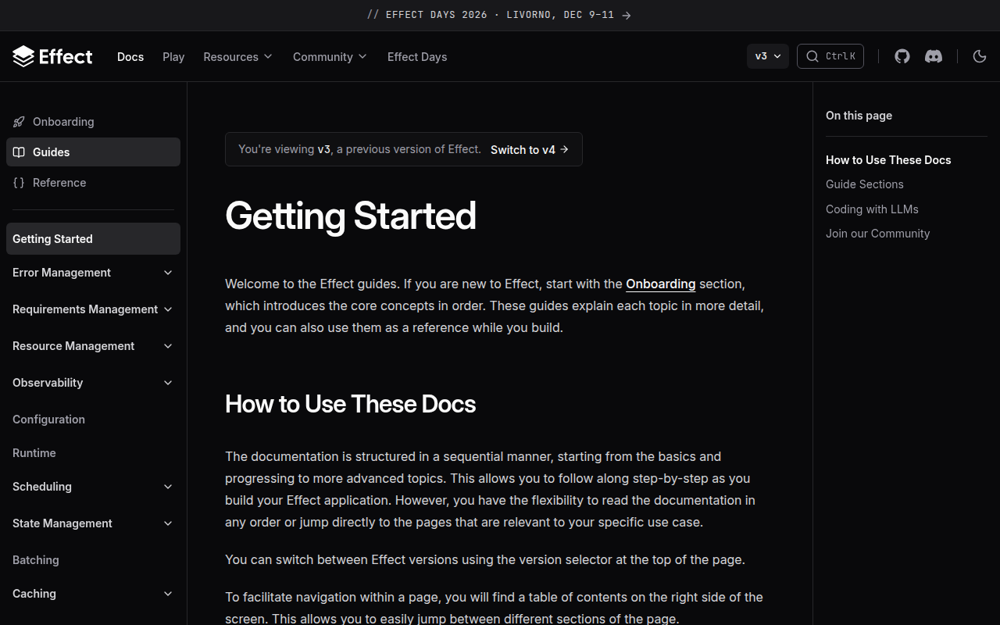
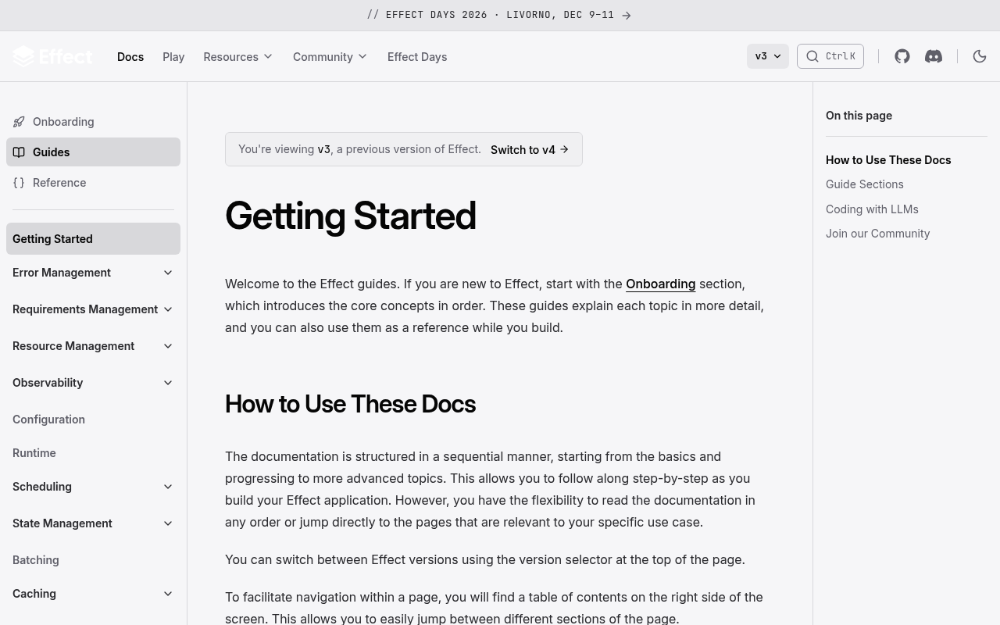
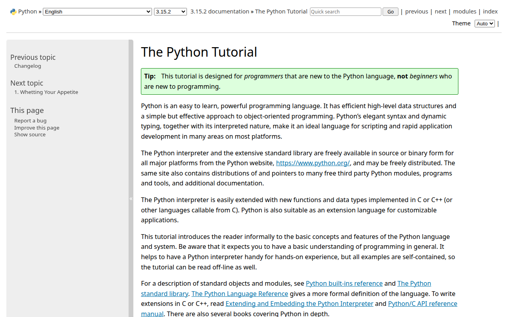
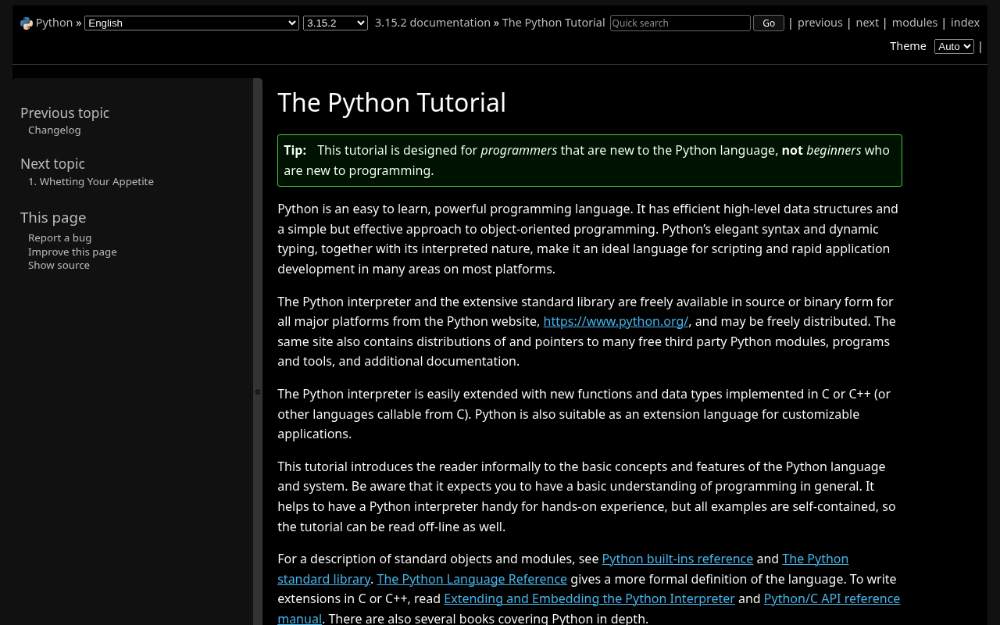

# Readable Theme

A Tampermonkey and Violentmonkey script that forces a light or dark appearance. It is meant for documentation sites that only ship a dark theme, and it can also darken a light page. The choice is remembered per site. The default is off, which leaves the page alone.

Effect's docs ship dark only. One press of the shortcut forces a light page:

The Python tutorial is light. A second press darkens it:

## Install

1. Install [Tampermonkey](https://www.tampermonkey.net/) or [Violentmonkey](https://violentmonkey.github.io/).
2. Open [readable-theme.user.js](https://raw.githubusercontent.com/aromaw/browser-scripts/main/readable-theme/readable-theme.user.js).

`@updateURL` and `@downloadURL` point at that file on `main`. The script runs at `document-start` on all http(s) pages, and not inside frames.

## How to use

`Alt+Shift+L` cycles **Off → Light → Dark**. It also works while a text field is focused. A small toast names the mode you just picked.

The userscript menu has **Light**, **Dark**, **Off**, and **Show floating button** / **Hide floating button**. The button is hidden until you turn it on. It sits at the bottom right, at low opacity until you hover it. Click cycles the mode. Shift-click hides it again. The menu choice is remembered for every site; the mode is remembered per host.

Off removes the script's changes and puts back theme storage this script edited. If the site itself painted the forced mode from the patched media query, Off reloads the page so that startup script can read the real preference.

## How it chooses a method

1. It patches `matchMedia` so a `prefers-color-scheme` feature reports the mode you picked. The rest of a compound query, including `max-width` and `not`, is still evaluated. That is enough for sites whose own script follows the media query.
2. It edits a theme hook only when the page already uses one and the value is a scheme token: `data-theme`, `data-color-mode`, `data-bs-theme`, a `dark` / `light` class, a known `localStorage` key (`theme`, `vitepress-theme-appearance`, `starlight-theme`, and a few others), or MkDocs Material's `data-md-color-scheme` (`default` / `slate`). A value such as `data-theme="claude"`, or MDN's `data-theme="light dark"`, is not treated as a switch.
3. It checks the painted background. If the site's own theme landed on the color you asked for, that is the result. If it did not, the script reverts those edits and sets `filter: invert(1) hue-rotate(180deg)` on the page. `img`, `video`, `canvas`, `iframe`, and inline background images get the same filter again so they keep their colors. Inline SVG icons invert with the text.

The first time you pick a mode on a host, the page is hidden for a moment while styles load, so the wrong theme does not flash. The next visit applies the remembered method before paint.

## Limitations

- A page whose colors come only from CSS `@media (prefers-color-scheme)` cannot have that media query rewritten. The `matchMedia` patch covers scripts. If the computed background is still wrong, the filter is used.
- Photos and logos that are `` elements are restored to their original colors. A white logo made for a dark background stays white, so it can disappear on the forced light background. Inline SVG icons follow the text instead.
- Background images set from a stylesheet, rather than an inline style, are inverted with the page.
- A filter on `<html>` becomes the containing block for `position: fixed`. Most pages are unchanged. A few fixed bars can shift.
- Scrollbars and form controls are nudged with `color-scheme`. Under the filter they can still look slightly off.
- The script does not run inside iframes.
- Memory is per host (including a non-default port). It is not per path.

## Development

From the repository root, `npm test` includes `tests/readable-theme.test.js` and a headless Chromium pass over local fixtures. `npm run theme-shots` rewrites the screenshots in `docs/screenshots/` from the live pages listed there.
